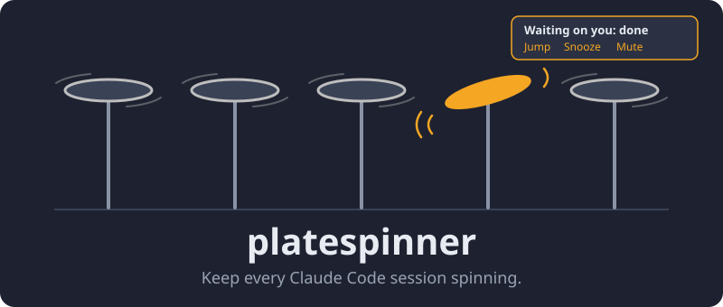

# platespinner



You're halfway through something with Claude when someone walks up with a
new problem. You open a new tab and start on it. Then another interruption,
another tab. Meanwhile the first session finished twenty minutes ago. It is
sitting in a tab you have forgotten about, waiting for you.

platespinner remembers for you. When a session finishes a turn or stops for
a permission prompt or a question, it gets a GNOME notification, and the
notification keeps coming back until you deal with it. Jump takes you
straight to the right kitty tab. Snooze buys you time, and Mute silences a
session you're done with. A session you're already looking at stays quiet.

Built for and tested on Ubuntu 26.04, GNOME Shell 50 on Wayland, kitty 0.45,
and system Python 3 with PyGObject. Notifications work in any terminal; Jump
and focus detection need kitty, or tmux running inside kitty.

## Install

    sudo apt install gir1.2-ayatanaappindicator3-0.1   # tray menu
    bin/platespinner install-kitten     # ~/.config/kitty/focus_with_token.py
    bin/platespinner install-hooks      # merges into ~/.claude/settings.json, backs it up first
    bin/platespinner install-service    # systemd --user unit, enabled and started
    ln -s "$PWD/bin/platespinner" ~/.local/bin/platespinner
    platespinner doctor

kitty needs `allow_remote_control yes` and `listen_on unix:/tmp/kitty` in kitty.conf.

## Use

    platespinner list
    platespinner snooze <id|name> [15m] | snooze --all [30m]
    platespinner wake <id|name>
    platespinner mute <id|name>
    platespinner name <id|name> "label"
    platespinner jump [<id|name>]       # no arg: longest waiting; switches kitty tab but can't raise the kitty window
    platespinner pause 1h | resume

Logs: `journalctl --user -u platespinnerd -f`.

The notification's Jump button also raises the kitty window. The CLI `jump`
can't: GNOME only lets a window come to the front with an activation token,
and only the notification click provides one.

## Uninstall

    platespinner uninstall-hooks
    systemctl --user disable --now platespinnerd.service
    rm ~/.config/systemd/user/platespinnerd.service
    rm ~/.config/kitty/focus_with_token.py ~/.local/bin/platespinner

Config and state live in `~/.config/platespinner/` and
`$XDG_STATE_HOME/platespinner/`; delete them too for a clean slate.

## How sessions are tracked

| Hook event | Effect |
|---|---|
| SessionStart, UserPromptSubmit, PreToolUse, PostToolUse, PostToolUseFailure | spinning |
| PreToolUse for AskUserQuestion | wobbling: question |
| PermissionRequest, Notification `permission_prompt` | wobbling: permission |
| Notification `elicitation_dialog` | wobbling: question |
| Notification `idle_prompt` | wobbling: done, never overrides an existing wobble |
| Stop, StopFailure | wobbling: done |
| SessionEnd | dropped, removed after `drop_grace` |

Tool events from subagents (`agent_id` set) do not mark a waiting session as
spinning. Every `reconcile_interval` the daemon also reads
`~/.claude/sessions/<pid>.json`: it adopts sessions it never heard about,
drops dead PIDs, and applies the file's `status` (busy, waiting, idle) when it
is newer than the last hook event. That is what clears a permission wobble
during a long-running approved tool, which fires no hook until it finishes.

## Terminals

Jump and focus detection work for sessions in kitty, and in tmux running
inside kitty. For tmux, the kitty window ids in claude's own environment are
stale (they come from whichever kitty started the tmux server), so the daemon
asks tmux which client shows the pane's session and reads that client's
environment instead. Jump then switches the tmux client to the pane and raises
the kitty window. Sessions in other terminals still get notifications; Jump
does nothing for them.

A session whose pane you are looking at (kitty has keyboard focus, the window
is active, and for tmux the pane is visible) gets no notification. Looking at
it counts as having seen it: when you leave, the next reminder comes one
interval later. If its banner is up when you focus it, the banner closes.

## Config

`~/.config/platespinner/config.toml`, reloaded live:

```toml
[reminders]
blocking_interval = "5m"    # permission and question
done_interval = "15m"       # finished turn
debounce = "3s"

[snooze]
default = "15m"
presets = ["5m", "15m", "1h"]

[detection]
ignore_non_interactive = true
reconcile_interval = "10s"
drop_grace = "30s"
```

State: `$XDG_STATE_HOME/platespinner/state.json`. Socket:
`$XDG_RUNTIME_DIR/platespinner.sock` (0600).

## Development

    python3 -m pytest
